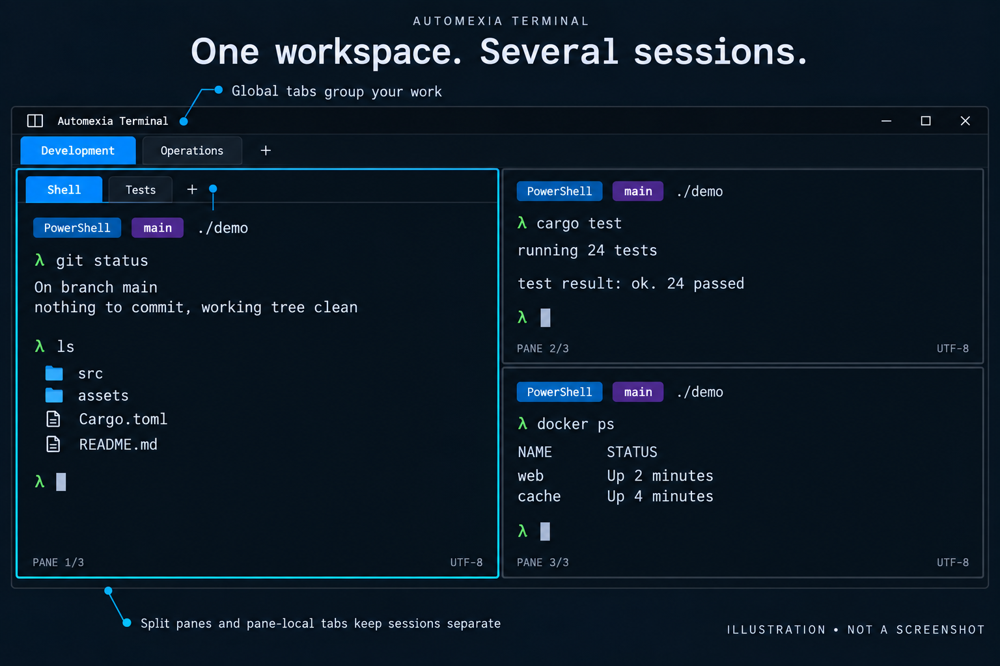
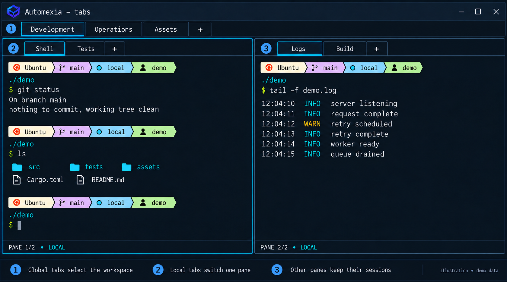
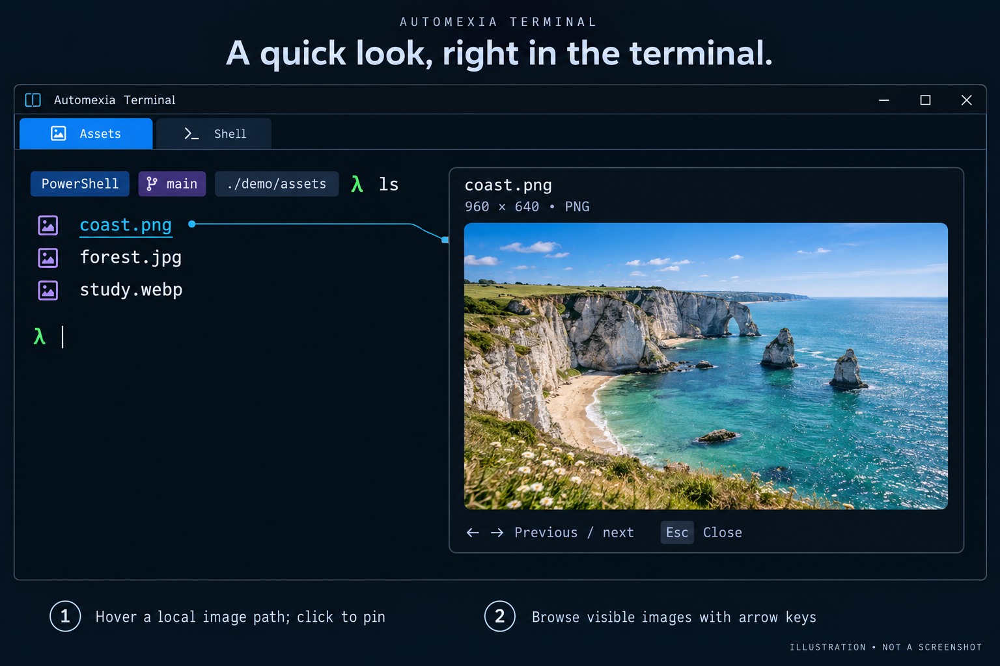
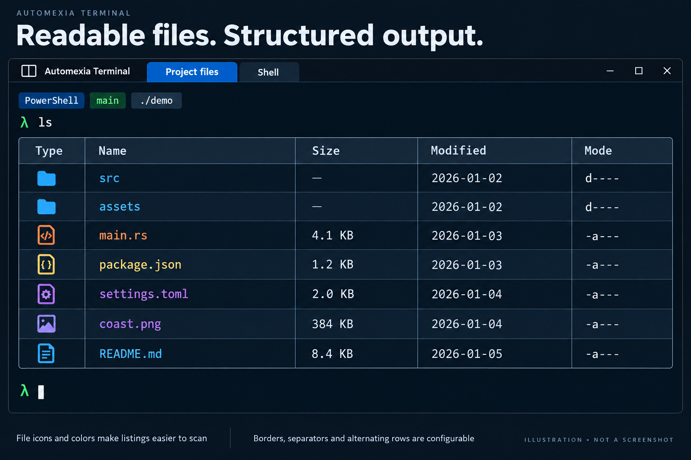
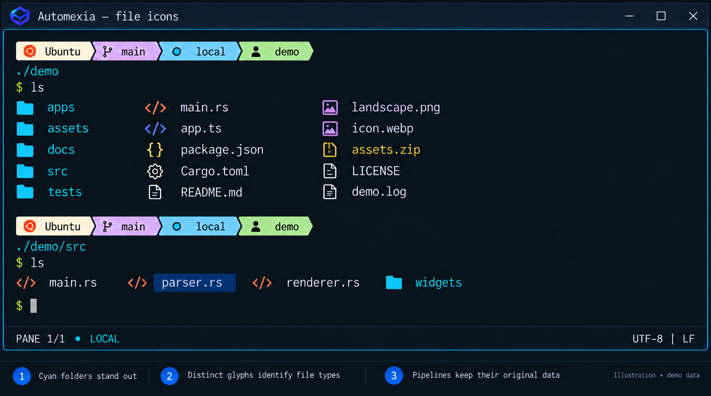
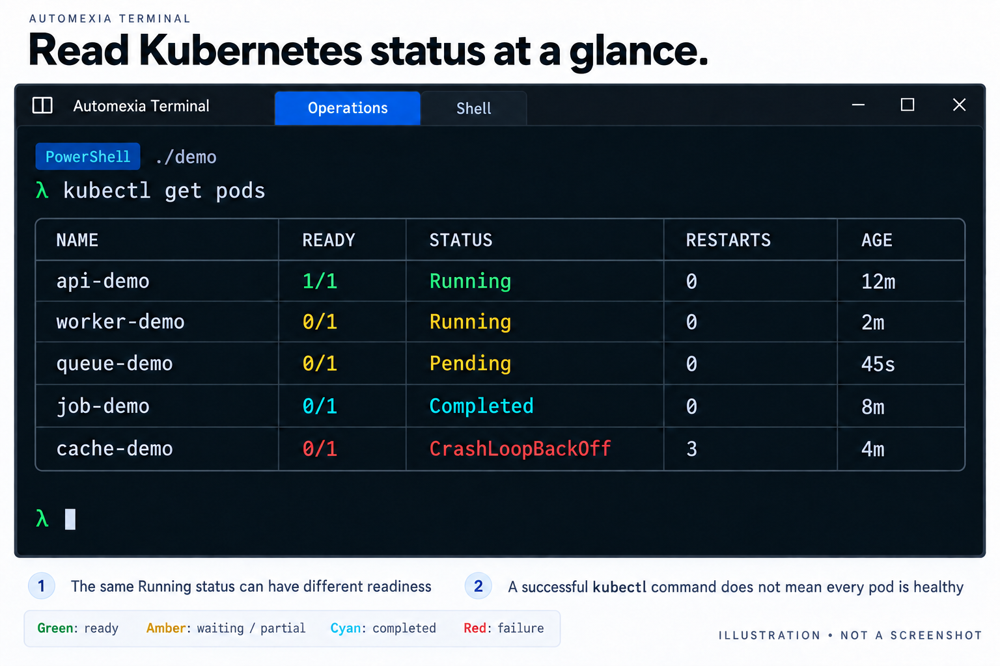

<p align="center">
  
</p>

<h1 align="center">Automexia Terminal</h1>

<p align="center">
  <strong>A cross-platform terminal for focused command-line work.</strong>
</p>

<p align="center">
  Keyboard-first · Direct shells · Structured workspaces · Local control
</p>

<p align="center">
  <a href="docs/INSTALLATION.md"><strong>Install</strong></a> ·
  <a href="docs/GETTING-STARTED.md">Get started</a> ·
  <a href="docs/user-guide/index.md">User guide</a> ·
  <a href="docs/FEATURES.md">Features</a> ·
  <a href="#feature-gallery">Gallery</a> ·
  <a href="docs/CONFIGURATION.md">Customize</a> ·
  <a href="CONTRIBUTING.md">Contribute</a>
</p>

<p align="center">
  <strong>Windows · Linux · macOS</strong> &nbsp;·&nbsp; Native shells &nbsp;·&nbsp; MIT
</p>

---

Automexia is a cross-platform terminal for Windows, Linux, and macOS.
Organize native shells and command-line tools with tabs, split panes, search,
and keyboard navigation. No account, hosted service, paid dependency, or AI
model is required.

Your shell controls command editing and execution. Your tools keep their own
credentials and settings.

## Why Automexia

- **Organize:** use windows, tabs, split panes, and pane-local tabs.
- **Find:** search panes, navigate marked commands, and discover keyboard actions.
- **Customize:** choose themes, fonts, shells, and shortcuts in settings or a TOML configuration file.
- **Stay in control:** paste and ordinary text insertion never submit commands.

## Feature gallery

These **AI-generated feature illustrations** use fictional demo data. They are
**not native screenshots or test evidence**. Layout and availability depend on
your build and settings. The style follows the
[landing-page reference](https://www.automexia.com/automexia-terminal-hero-native-v9.png).

### Split panes



Keep files, tests, container output, and logs visible together. Each session runs
independently. A border marks the pane receiving keyboard input; drag dividers
to give a busy session more room.
See [Workspaces](docs/user-guide/workspace.md) and [Keyboard](docs/KEYBOARD.md).

### Global tabs and pane-local tabs



Top-level tabs organize work within the window. Pane-local tabs switch the
session shown in one pane while the surrounding panes stay in place. The example
keeps **Shell / Tests** on the left and **Logs / Build** on the right, making the
two levels of navigation visible. See [Workspaces](docs/user-guide/workspace.md).

### Local image preview



Hover a supported local image path for a quick look, or click to pin the preview.
While pinned, use the arrow keys to browse visible image paths and Escape to
close. The preview keeps the image's aspect ratio and stays inside its pane.
Keyboard users can select a path and invoke **Preview Selected Image** from the
command palette, or use `Ctrl+Alt+I` on Windows/Linux and `Cmd+Alt+I` on macOS.
See [Image previews](docs/IMAGE-PREVIEWS.md).

### Bordered tables



Recognized header tables gain aligned, bordered cells. **Inline tables** controls
the outer frame, row and column separators, border style and weight, and optional
alternating backgrounds. The illustration shows container output and a small
generic table; this is presentation over terminal text, and copied output keeps
the underlying text. See [Customization](docs/user-guide/customization.md).

### File icons and colors



Enhanced interactive listings use compact glyphs and colors to make folders and
file types easier to distinguish. Filenames remain ordinary terminal text for
selection and copying. Native pipeline data stays intact; the decoration belongs
to the interactive display. See
[Shell integration](docs/SHELL-INTEGRATION.md#icon-aware-listings).

### Kubernetes status colors



Recognized plain-text output distinguishes healthy readiness, partial or waiting
states, completed jobs, and failures. Both the status and readiness matter:
`1/1 Running` is green, while `0/1 Running` is amber. A successful `kubectl get`
does not imply that every pod is healthy. Tool-supplied ANSI colors retain
priority. See [Operational status colors](docs/user-guide/commands-and-shell.md#operational-status-colours).

## Platforms and package status

Build and run Automexia on **Windows, Linux, or macOS** using the same
[source workflow](docs/INSTALLATION.md). Each platform has native shell, PTY,
windowing and rendering adapters. BSD and other Unix systems are best-effort.

| Platform | Native terminal path | Build and run |
|---|---|---|
| Windows | ConPTY; PowerShell, CMD and WSL integration | MSVC toolchain and Windows SDK |
| Linux | Unix PTY; X11 and Wayland | Distribution development libraries |
| macOS | Unix PTY; native macOS windowing and Metal/WGPU | Xcode Command Line Tools |

Download published builds from **[this repository's Releases](https://github.com/AmjedAllaya/automexia/releases)**.
The current prerelease candidate is `v0.0.3-alpha`: Windows x64/Arm64
MSI and portable ZIP, Linux x64/Arm64 DEB/RPM/tar.gz, and a universal macOS DMG.
A package is available only after its native validation, signing and publication
gates pass; this source change alone does not mean the release is published.
The former separate binary repository is retired for new releases.

See [Platform support](docs/PLATFORMS.md) for native evidence and limitations,
and [Release trust](docs/RELEASE-TRUST.md) for package verification.

## What Automexia provides

### Workspaces, windows, tabs, and panes

Use independent windows, top-level tabs, split panes, and pane-local tabs.
Fresh sessions start with defaults. Clones copy the shell profile and validated
working directory into a new session. Each session has its own pseudo-terminal
(PTY), the connection between a shell and the terminal.
Input, search, selection, resize, and cleanup stay tied to their session.

See [Workspaces](docs/user-guide/workspace.md).

### Real shells and native PTYs

Run PowerShell, CMD, WSL, Bash, Zsh, Fish, and other compatible shells normally.
Integration features vary by shell. Sessions use Unix PTYs or Windows ConPTY.
The shell controls history, quoting, completion, aliases, pipelines, and execution.

See [Commands and shell](docs/user-guide/commands-and-shell.md).

### Terminal behavior

The engine handles terminal control sequences, Unicode, scrollback, resize
reflow, selection, clipboard, mouse reporting, hyperlinks, and command navigation.
It bounds untrusted control strings and reports session exit and cleanup.
Displayed output becomes terminal input only through an explicit user action.

### Search and command discovery

Search the selected pane or visible workspace where your build supports it.
Navigate marked commands and use the command palette to find actions. Open it
with `Ctrl+Shift+P` on Windows/Linux or `Cmd+Shift+P` on macOS.
Overlays capture their own input so keystrokes do not reach the shell.

See [Keyboard](docs/KEYBOARD.md) for exact shortcuts. Use documentation and
`--list-keybinds` for your installed version; package and source defaults may differ.

### Images and rendering

The terminal handles Sixel, Kitty, and iTerm2 image protocols, plus local previews
of supported formats such as PNG and JPEG. File size and decoding limits keep
previews bounded. Images preserve the terminal grid, selection, and cursor.

See [Image previews](docs/IMAGE-PREVIEWS.md) and [Architecture](docs/ARCHITECTURE.md).

### Appearance, configuration, and migration

Configure themes, fonts, cursor, opacity, spacing, shells, windows, shortcuts,
and platform overrides in TOML. Invalid reloads keep the last working settings.
Starter generation refuses to overwrite files. Rio configuration import preserves
the original files. Ghostty keybinding migration previews changes and creates a
backup before applying them.

See [Configuration](docs/CONFIGURATION.md), [Migration](docs/MIGRATION.md), and
[Ghostty keyboard compatibility](docs/GHOSTTY-KEYBOARD-COMPATIBILITY.md).

### Accessibility

Automexia provides keyboard operation, visible focus, high contrast, reduced
motion, and accessibility semantics. Native assistive-technology evidence is
separate from source tests. See [Accessibility](docs/ACCESSIBILITY.md).

### OpenSSH interoperability

Run system `ssh`, `scp`, and `sftp` in a pane. OpenSSH and the operating system
manage credentials, host keys, authentication, configuration, and networking.
Optional local inventory reads selected metadata; it does not connect or log in.

See [Remote connections](docs/guide/remote-connections.md) and
[SSH inventory](docs/SSH-INVENTORY.md).

### Local command productivity

Current source includes four command groups:

- `automexia actions`: manage saved commands and Quick Actions.
- `automexia aliases`: manage Automexia-generated shell shortcuts.
- `automexia packs`: inspect built-in action packs and copy selected actions locally.
- `automexia workspaces`: inspect workspace definitions and preview changes.

Read operations do not start providers, connections, sessions, or tasks.
Changes require an explicit preview and action.

Use your version's `--help` and [CLI reference](docs/CLI-REFERENCE.md).
[Features](docs/FEATURES.md) records availability;
[Command productivity](docs/COMMAND-PRODUCTIVITY.md) explains the boundaries.

## Build and run Automexia

Clone the [public source repository](https://github.com/AmjedAllaya/automexia)
and follow [Build and run](docs/INSTALLATION.md) for Windows, Linux or macOS
prerequisites. Use the same contributor commands on each platform. Source builds
are local builds, not signed release packages.

For the separate existing Linux prerelease, use only its versioned official
assets and [package verification instructions](docs/INSTALLATION.md#verify-a-linux-early-access-package).
GitHub-generated source archives are not installed application packages.

A contributor-oriented first launch is:

```text
cargo dev
```

After the full gate has passed, the faster incremental application workflow is:

```text
cargo automexia
```

The project currently requires the Rust toolchain selected by
`rust-toolchain.toml`; the workspace minimum Rust version is declared separately
in `Cargo.toml`.

## Application command line

The installed application entry point is:

```text
automexia [OPTIONS] [COMMAND]
```

Use `--working-dir <PATH>` to choose a starting directory, or put
`-e <PROGRAM> [ARGS...]` last to launch a specific program. Arguments are passed
exactly; enter pipelines, aliases, redirects, and expansion in a shell.

Use `--help` for your build's options. See [CLI reference](docs/CLI-REFERENCE.md)
for configuration, logging, integration maintenance, and local command families.

## Architecture

The application coordinates sessions, input routes, and renderer snapshots.
The VT parser interprets terminal control sequences; PTY adapters manage the
shell connection and processes. Optional components use versioned contracts
through an application-owned broker.

Each state and resource has one owner. Output updates terminal state, publishes
an immutable snapshot, then requests a frame. Input goes to the focused session.
See [Architecture](docs/ARCHITECTURE.md) for the full design.

### Workspace structure

The Rust workspace contains the desktop application (`apps/automexia-terminal`),
product contracts (`automexia-*`), terminal and rendering crates, optional
adapters (`extensions/`), and contributor tools (`tools/`).

The workspace uses Rust 2021 and is MIT-licensed.
`Cargo.toml` lists packages and dependencies. See
[Architecture](docs/ARCHITECTURE.md#layers) for their roles and the
[Source map](docs/developer/source-map.md) for documentation owners.

## Security and trust model

Terminal output, files, configuration, clipboard, metadata, and optional
component data are untrusted. Parsing is bounded, launches use exact argument
arrays, and paste stays tied to its session without adding Enter.
Configuration changes are transactional; optional capabilities are denied by
default. Processes and workers have explicit cleanup owners.

Report vulnerabilities privately under the [Security policy](SECURITY.md).
Never include credentials, private infrastructure, or terminal history in public issues.
See [Release trust](docs/RELEASE-TRUST.md) for artifact verification.

## Extension and capability boundary

Automexia v0.4 does not claim a public third-party marketplace, download
service, or unrestricted component execution. Optional code receives only
reviewed capabilities. It cannot silently access history, clipboard, files,
networking, credentials, processes, or PTYs. Disabling it must leave the base
terminal usable. See [Extensions](docs/EXTENSIONS.md).

## Development and contribution

Install prerequisites from [Installation](docs/INSTALLATION.md), then use:

| Command | Purpose |
|---|---|
| `cargo dev` | Run the full contributor gate, build, and launch. |
| `cargo automexia` | Incremental build and launch after the full gate passes. |
| `cargo ready` | Run the full contributor gate without launching. |
| `cargo ci` | Run the repository CI profile. |
| `cargo qa` | Run deeper assurance checks. |

The full gate checks source, formatting, lint, tests, dependencies, and executable
identity. Platform changes also need native evidence. See
[Contributing](CONTRIBUTING.md), [Testing](docs/TESTING.md), and
[AI contributor workflow](AGENTS.md). Contributions require DCO 1.1 sign-off
(`git commit -s`).

## Testing and assurance

Tests cover source correctness, conformance, concurrency, fuzzing, rendering,
and dependency policy. Native display, PTY, accessibility, packaging, signing,
and hardware claims require evidence from those paths.

See [Testing](docs/TESTING.md), [Readiness](docs/READINESS-AUDIT.md), and
[Feature test reinforcement](docs/FEATURE-TEST-REINFORCEMENT.md).

## Documentation map

- [User guide](docs/user-guide/index.md): everyday tasks.
- [Configuration](docs/CONFIGURATION.md), [Keyboard](docs/KEYBOARD.md), and
  [CLI](docs/CLI-REFERENCE.md): exact reference.
- [Features](docs/FEATURES.md) and [Platforms](docs/PLATFORMS.md): current status.
- [Documentation home](docs/index.md): all guides and contributor references.

## Documentation and release boundary

Source implementation, disabled code, release-gated behavior, and published
availability are different states. Package names and tests do not announce a
release. [Features](docs/FEATURES.md) and release documentation own availability.

Public docs cover current behavior. See the
[Private documentation policy](docs/PRIVATE-DOCUMENTATION-POLICY.md) for publication rules.

## Brand and visual identity

The application mark is `assets/brand/automexia-terminal-source-512.png`.
Platform assets derive from it. Stable publication requires the rights evidence,
source assets, variants, and approval tracked in `assets/brand/ASSET-MANIFEST.toml`.
See [Brand guide](docs/BRANDING.md).

## Upstream heritage

Automexia preserves Rio's Git history and copyright notices. Later upstream
changes are reviewed and adapted individually. See [UPSTREAM.md](UPSTREAM.md),
[NOTICE.md](NOTICE.md), and [Third-party notices](THIRD_PARTY_NOTICES.md).

## License

Automexia Terminal is available under the [MIT License](LICENSE).

---

<p align="center">
  <strong>Automexia Terminal</strong><br>
  A cross-platform terminal for focused command-line work.<br><br>
  <a href="docs/INSTALLATION.md">Install</a> ·
  <a href="docs/index.md">Documentation</a> ·
  <a href="docs/FEATURES.md">Feature status</a> ·
  <a href="SECURITY.md">Security</a> ·
  <a href="CONTRIBUTING.md">Contribute</a>
</p>
